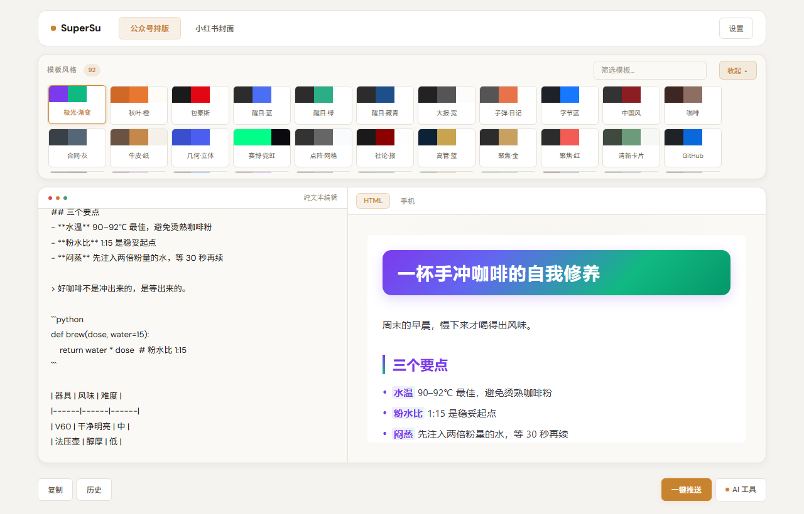
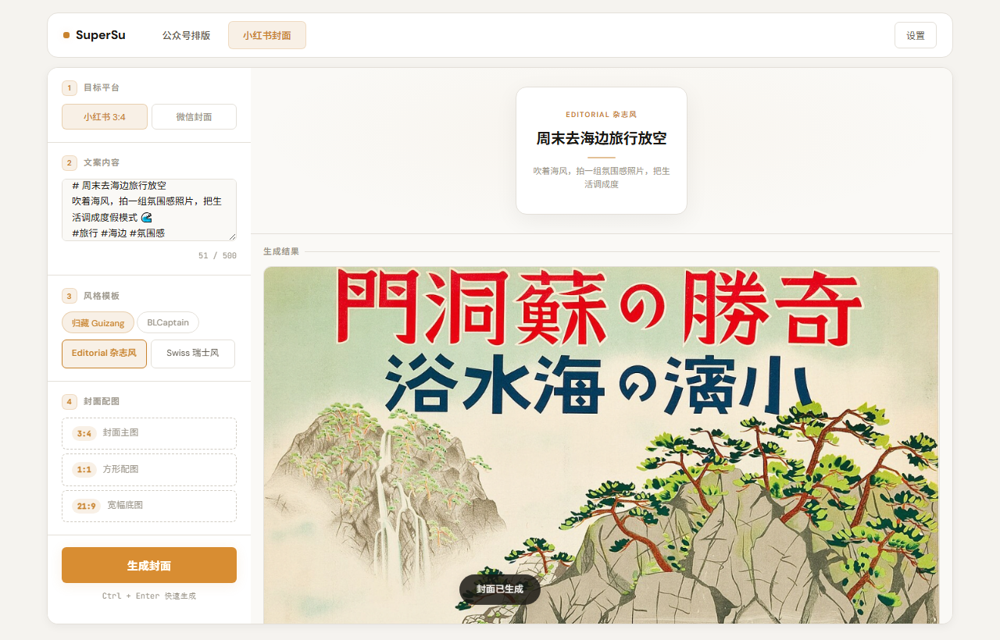
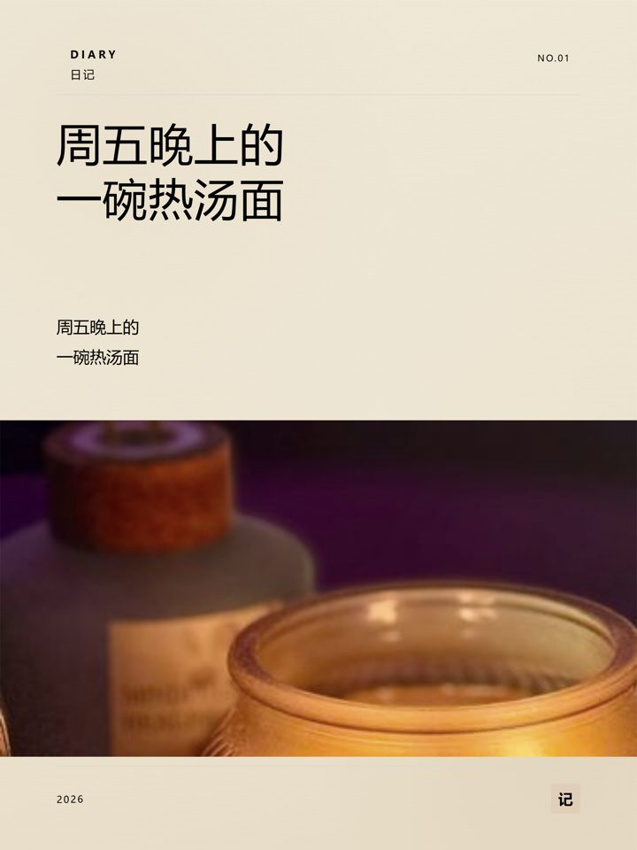
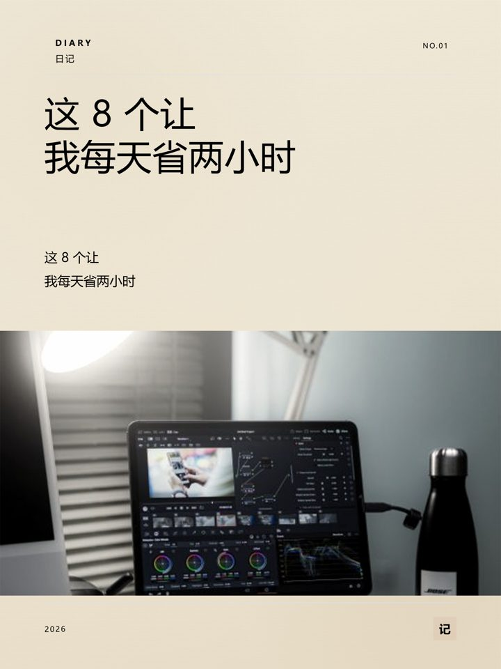
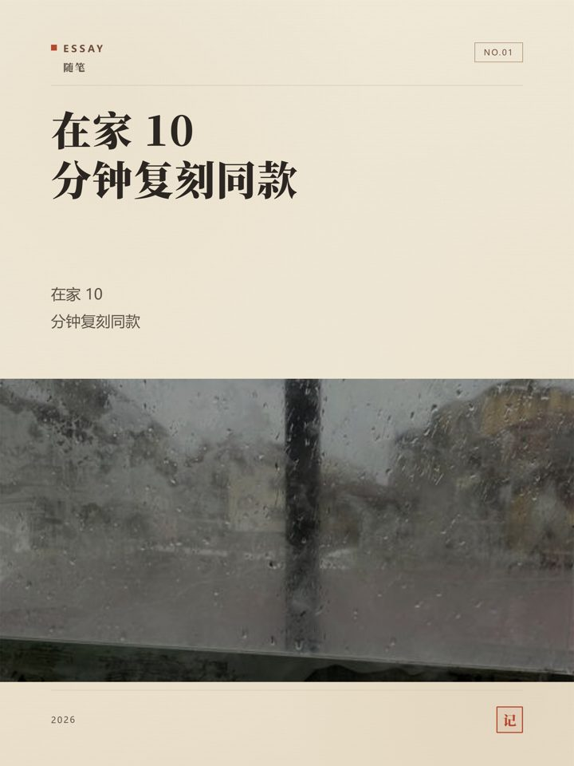
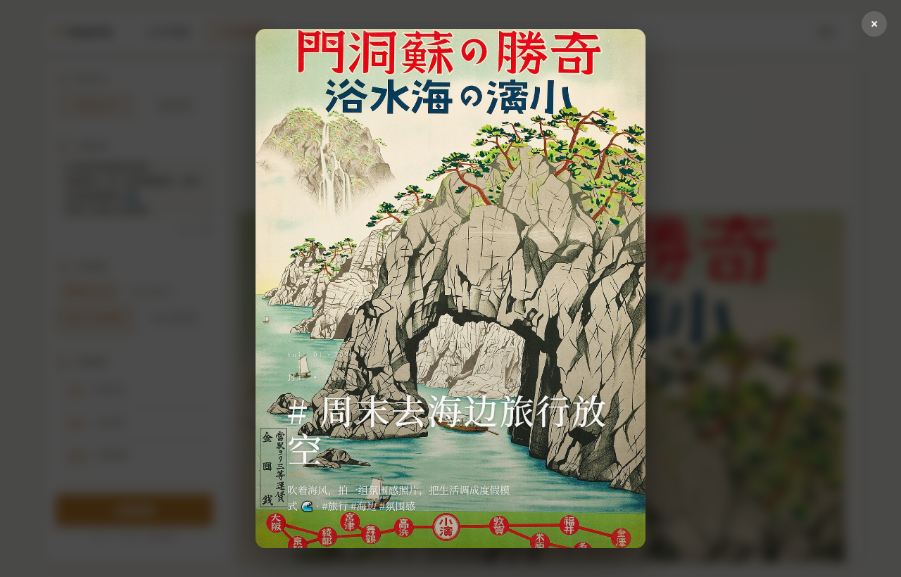
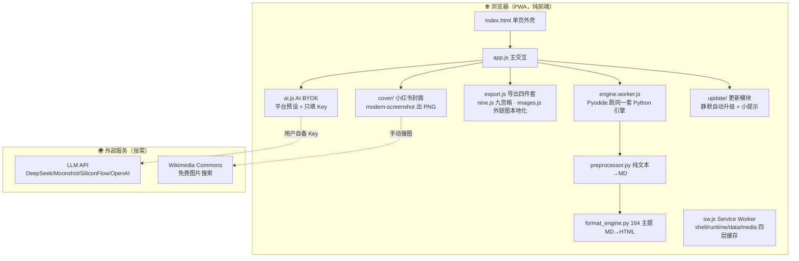

# 🚀 SuperSu 公众号编辑器 — 排版 + 小红书封面，一条龙

> **别再为排版跟编辑器搏斗半小时。**
> 粘贴纯文本 → 好看的公众号排版；一句话 → 小红书封面（归藏风格一次出 3 尺寸）。
> 数据不出门 · 默认零 AI · 开箱即用。
>
> 🌐 **在线版（PWA，推荐，免安装）**：<https://supersu.ccwu.cc>
> 备用地址：<https://supersu-pwa.pages.dev>
>
> 📊 **当前版本 / 构建号 / 测试状态**：见 [`STATE.md`](STATE.md)（脚本自动生成，唯一真源）
> 🗄️ **本地 Flask 版已于 2026-10-28 封存**（不再随仓库提供），取回方式见 [`ARCHIVE.md`](ARCHIVE.md)。
>
> 📌 **阅读提示**：本项目只有 **PWA 一个版本**。文中若出现「本地版 / 5000 端口」字样，
> 均属历史描述，不代表现状。

[](https://python.org)
[](https://playwright.dev)
[](STATE.md)
[](#-license)

<p align="center">
  
  &nbsp;
  
</p>
<p align="center"><i>左：公众号排版（164 套主题 · 实时预览）｜ 右：小红书封面（12 风格 · 3 尺寸）</i></p>

---

## 🖼️ 真实产出

<p align="center">
  
  &nbsp;
  
  &nbsp;
  
</p>
<p align="center">
  
  &nbsp;
  
  &nbsp;
  
</p>
<p align="center"><i>旅行 · 咖啡探店 · 情感治愈 · 效率工具 · 美食 · 家居收纳 —— 六种主题 × 六种风格，底图来自联网检索（Pexels），全部一键生成</i></p>

---

## 💥 为什么是 SuperSu

| 😫 你可能正在经历 | ✅ SuperSu 给你的 |
|:------------------|:------------------|
| 公众号后台调格式半小时，粘过去还是乱 | **粘贴即排版**：164 套主题、实时预览、复制即得 |
| 小红书封面不会设计、请设计又太贵 | **一句话生成封面**：归藏风格一次出 3:4 / 1:1 / 21:9，另有 10 套模板出 3:4（PWA 纯前端、可离线） |
| 在线工具要注册账号、文案上传到别人服务器 | **数据不出门**：纯前端运行，Key 只存本机浏览器，内容不上传 |
| AI 工具每篇文章都烧 token、还越改越怪 | **默认零 AI**：本地规则引擎，需要 AI 时折叠在弹窗里随叫随到 |
| 网上搜配图十分钟，配出来还不搭 | **联网搜图不硬塞**：Pexels 搜图（中文可搜）/ 上传 / 纯色；搜不到会明说，绝不硬塞无关图片 |

> 🧭 **核心理念：不做不需要的事。** 默认就是「输入 → 排版」，AI 全部折叠，点了才展开。

---

## ⚡ 30 秒上手

```
        📝 公众号排版                      🖼️ 小红书封面
   ┌─────────────────────┐          ┌─────────────────────┐
   │ ① 📋 粘贴你的文章     │          │ ① 🎯 选「发到哪」+样式 │
   │    （第一行自动当标题）│          │ ② ✍️  写文案          │
   │ ② 🎨 点色卡选主题      │          │ ③ 🚀 点生成 → 一次 3 张│
   │ ③ 📋 点「复制」直接发  │          └─────────────────────┘
   └─────────────────────┘
```

> 💡 **第一次用？** 不需要教程：排版页粘正文就能看到效果，封面页写文案就有实时预览。

---

## 📊 一图看懂 SuperSu 有多少家底

| | | | | |
|:---:|:---:|:---:|:---:|:---:|
| **164**<br>🎨 排版主题 | **12**<br>🖼️ PWA 封面风格 | **3**<br>📐 输出比例 | **见<br>STATE.md**<br>🧪 自动化测试 | **0**<br>💸 默认模式 AI 开销 |

- 🎨 **164 套排版主题** = 45 套早期原创 + 119 套自研原创（深色首屏 / 杂志大字 / 纸感手记 / 暗底沉浸 / 便签 / 网格 / 终端 / 新粗野 / 极简 / 商务 / 文艺 / 科技 / 节庆……）
- 🖼️ **13 种封面风格** = 归藏 3 套（杂志 / 瑞士 / **大字版**，支持 3 尺寸）+ 10 套模板（3:4），全部纯前端渲染、可离线
- 🔤 **大字版**（2026-10-28 新增）：**不用底图**也能出封面，选了图也不铺 —— 永远不会「图文不符」，也是出图最快的一套
- 🧪 **自动化测试**：本地层 + 线上层 + 扩展层 + 有头全量（164 套模板 × 3 夹具）+ 移动端专项，全部 0 控制台报错；实时数字见 [`STATE.md`](STATE.md)

---

## ✨ 核心功能

| 🎯 功能 | 💡 说明 |
|:--------|:---------|
| **📝 自动排版** | 粘贴纯文本 → 自动识别标题 / 列表 / 引用 → Markdown → **164 套主题**任选（纯本地规则，零延迟零费用） |
| **🖱️ 点卡换装** | 点击色卡立即切换预览；**最近使用 + 收藏**自动置顶，常用的永远在手边 |
| **🖼️ 小红书封面** | 输入文案 → 选风格 → 归藏风格生成 **3:4 / 1:1 / 21:9**，模板风格生成 3:4；12 风格（纯前端、可离线），标题字号自适应 |
| **🌐 联网搜图** | **Pexels 搜图（中文可搜，BYOK 免费 Key）/ 上传本地图 / 纯色**，失败必给原因，**绝不硬塞无关图片** |
| **⏳ 生成有反馈** | 生成中显示真实阶段（找底图 → 排版 → 完成），按钮置灰防重复点，不让你对着一动不动的界面干等 |
| **🤖 AI 润色 / 摘要 / 排版** | 折叠在弹窗里按需展开；**平台下拉预置（DeepSeek / Moonshot / SiliconFlow / OpenAI），选中自动填地址和模型，只需再填 API Key**；AI 失败自动本地兜底并说明原因，**永不静默** |
| **🚀 一键推送**（❗已封存，当前不可用） | 原 Flask 版的「推送到微信草稿箱 + 推送历史」，随本地版一起封存（见 [`ARCHIVE.md`](ARCHIVE.md)）；有需要可以移植回 PWA |
| **🔒 数据不出门** | 纯前端运行，Key 只存本机浏览器（localStorage），正文与图片都不上传 |
| **📖 内置教程**（❗已封存，当前不可用） | 原本地版的两页教程随封存移除；PWA 靠实时预览自解释，不需要教程 |

---

## 📝 公众号自动排版

顶部紧凑模板条展示常用主题的配色色卡（收藏 / 最近优先，最多 40 个）；**全部 164 套**在「全部风格」抽屉里，可搜索、可按「版式 × 色调」二维筛选。下方左侧输入区支持实时预览，右侧手机框实时渲染，复制按钮写入**富文本**——粘贴到公众号后台，样式原样保留。（「插入模块」下拉属已封存的本地版；PWA 直接写 `:::` 围栏语法即可，见下方排版能力。）

### 排版能力一览

- ✅ 标题 h1–h6、粗体、斜体、行内代码、链接
- ✅ 有序 / 无序列表（嵌套 3 层）
- ✅ 引用块、代码块（语法高亮）、表格
- ✅ Callout（tip / note / warning）
- ✅ 脚注、图片占位符
- ✅ **排版模块**（`:::` 围栏语法，可插入到正文任意位置）：
  `eyebrow` 小标签 / `cards` 卡片组 / `summary` 要点总结 / `cta` 行动引导 /
  `stat` 关键数字 / `steps` 步骤流程 / `timeline` 时间线 / `compare` 对比卡片 /
  `quote` 引文卡 / `dialogue` 对话气泡 / `gallery` 图集 / `longimage` 长图
- ✅ **四种页面布局**（由主题的 `layout` 字段决定）：普通排版、`card` 卡片分节、
  `hero` 深色首屏 + 大序号 + 交替色带 + 引文穿插、`timeline` 左侧时间线
  （色带按主题强调色派生，保证肉眼能看出深浅交替，不会淡成看不见）
- ✅ 模块配色跟随主题色系（accent / 正文色 / 页面底色），切换主题时模块一起换装
- ✅ 全部由**纯本地正则规则**完成预处理，零 AI 参与
- ✅ **智能排版**（可选 AI）：AI 只出结构决策、不改写正文，失败自动本地兜底并说明原因

---

## 🖼️ 小红书一键生成封面

输入一段文案，选一个风格，点「生成封面」——系统自动完成：

1. 🔍 从文案中提取关键词（本地词典，纯规则）
2. 🌐 准备底图：**PWA** 手动搜图（Wikimedia 免 key）/ 上传 / 纯色三选一；**本地版** 自动搜图（Pexels 中文优先 → Wikimedia 兜底）
3. 🎨 把文字 + 底图合成封面（**标题字号自适应**，长文案不溢出）
4. 📸 输出 3 尺寸（归藏风格）/ 3:4（模板风格）+ 署名来源 + 生成过程实时可见

<details>
<summary><b>🔍 本地版底图自动搜索机制（PWA 为手动搜图，点开看本地版流程）</b></summary>

```
用户文案 "周末去海边旅行放空"
    ↓ 提取关键词（本地词典，纯规则）
关键词 = "travel"
    ↓ 双轨搜索（中文查询自动走 zh-CN）
┌─ Pexels API（推荐配置，原生支持中文）← 图最贴题，200 次/时
│   └── 竖版优先 · 返回高清摄影作品 + 作者 + 许可证
│
└─ Wikimedia Commons（无需任何 Key）✅ 开箱即用
    └── 返回 CC / Public Domain 作品（偏百科/地理，中文场景可能不贴题）
         ↓ 联网成功的结果缓存到 data/bg_cache/（降级结果不缓存，不会固化错图）
    注入封面引擎（归藏 data URI 内嵌 / BLCaptain 文件路径）
         ↓
    用户看到：真实照片底图 + 中文标题叠加 + 底图署名条
    搜不到时：明确提示「联网没找到」，绝不硬塞无关图片
```

</details>

> 💡 **想让配图更贴题（本地版）？** 到 [pexels.com/api](https://www.pexels.com/api/) 免费申请 key，右上角「设置」→「Pexels 图库 API」里粘贴，**保存后立即生效**（或写进 `.env`）。PWA 版暂无 Pexels 接入（浏览器直连不稳），用 Wikimedia 免 key 搜图。

### 封面引擎阵容

| 版本 | 引擎 | 风格数 | 风格名 | 特点 |
|:-----|:-----|:------:|:-------|:-----|
| PWA（主） | 纯前端（modern-screenshot） | 12 | 归藏：杂志 / 瑞士（各 3 尺寸）+ 10 套模板（3:4） | 无后端、可离线、长标题自适应 |
| 本地版（弃用） | 归藏 Guizang | 2 | Editorial 杂志风 / Swiss 瑞士风 | HTML 模板 + Playwright 截图 |
| 本地版（弃用） | BLCaptain | 9 | 雾野 / 暖书房 / 海岸 / 夜纹 / 炉台 / 电蓝 / 石墨薄荷 / 安全珊瑚 / 酸性青柠 | Node.js CLI + Playwright，标题字号自适应 |

<details>
<summary><b>🖼️ 更多界面截图</b></summary>

<p align="center">
  
  &nbsp;&nbsp;
  
</p>
<p align="center"><i>左：结果画廊网格 ｜ 右：Lightbox 全屏大图（含底图署名）</i></p>

</details>

---

## 🎨 主题一览

**164 套主题** = 45 套早期原创 + 119 套自研原创（`su-*` 前缀）

### 早期原创系列（45 套）

| 系列 | 代表主题 | 风格 |
|:-----|:---------|:-----|
| 卡片系 | warm-card / fresh-card / ocean-card | 温暖卡片 |
| 深度长文 | newspaper / magazine / ink / coffee-house | 杂志质感 |
| 科技产品 | bytedance / github / sspai / midnight | 极客暗调 |
| 文艺随笔 | terracotta / mint-fresh / sunset-amber / lavender-dream | 温柔色调 |
| 活力动态 | sports / bauhaus / chinese / wechat-native | 高对比 |
| 模板布局 | bold-blue / bold-navy / bold-green / focus-gold | 干净利落 |

### 自研系列（119 套，`su-*` 前缀）

全部由本项目的主题生成器产出：只声明「底色 / 墨色 / 强调色 / 字体气质」，字号标尺、间距、圆角、
描边、列表、代码块、暗色适配由统一设计系统推导，因此 119 套彼此协调、切换主题时不会忽大忽小。
六族 72 套更进一步：族级视觉技法（粗边 / 硬投影 / 虚线 / 冷光面板等）由生成器的族系统推导，
色值 = 色调色相 × 族级饱和·明度基线，全部为本项目自研数值。

| 系列 | 代表主题 | 布局 | 风格 |
|:-----|:---------|:-----|:-----|
| 首屏家族（10） | su-dusk-slate / -amber / -azure / -mauve / -sage … | `hero` | 深色首屏 + 大序号 + 交替色带 + 引文穿插 |
| 素排文档 | su-academic / su-quietdoc / su-glacier / su-gridline | — | 无装饰，靠字号与留白分层 |
| 杂志编辑部 | su-broadsheet / su-classicmuse / su-studio / su-gilded / su-roundtable | — | 大号衬线 + 强调色开篇 |
| 纸感手记 | su-scrollwork / su-notebook / su-xuanink / su-typograph / su-crimsonwashi … | — | 纸底 + 衬线/楷体，耐读 |
| 暗底沉浸 | su-nightsky / su-lamplight / su-console / su-drafting / su-neonwave | — | 暗底 + 高对比强调 |
| 分层卡纸 | su-frost-card / su-frostedglass | `card` | 大圆角浮起卡片分节 |
| 数据技术 | su-gauges / su-hardedge | — | 表头反白 / 粗黑边 |
| 明快活泼 | su-confetti / su-macaron / su-stickynote / su-picturebook | — | 多色点缀 + 大圆角 |
| 特殊节奏 | su-ribbon（色带）/ su-countdown（大序号）/ su-deepwater（暗色首尾屏）/ su-milestone（时间线） | `hero` / `timeline` | 单一手法做满 |
| 六族·十二色（72） | su-stamp-*（钢印）/ su-minimal-*（素页）/ su-biz-*（公文）/ su-letter-*（信笺）/ su-night-*（夜航）/ su-feast-*（节庆） | — | 新粗野 / 极简 / 商务 / 文艺 / 科技 / 节庆，每族 12 色调 |

---

## 🏗️ 架构

**主产品：PWA（无后端，浏览器里跑一切）**



<details>
<summary><b>本地版（Flask，已弃用，保留回退）架构</b></summary>

```mermaid
graph TB
    subgraph Frontend["🌐 前端 SPA"]
        A[index.html<br/>单页应用]
        A --> B[公众号页 #page-wechat]
        A --> C[小红书页 #page-social]
        B --> B1[模板色卡条 .tpl-strip<br/>164 套主题 · 点击切换 · 收藏置顶]
        B --> B2[输入区 + 手机预览]
        C --> C1[控制面板]
        C --> C2[结果画廊 + Lightbox]
    end

    subgraph Backend["⚙️ Flask 后端"]
        D[app.py<br/>路由 + SSE + API]
        D --> E[/api/render<br/>Markdown 渲染]
        D --> F[/api/social/generate<br/>封面生成]
        D --> G[/api/polish /summary<br/>AI 可选]
        D --> H[/api/push<br/>微信推送]
    end

    subgraph Engines["🔧 渲染引擎"]
        E --> E1[preprocessor.py<br/>纯文本→MD]
        E1 --> E2[format_engine.py<br/>164 主题 MD→HTML]
        F --> F0[image_search.py<br/>联网搜真图]
        F0 --> F1[guizang_renderer.py<br/>归藏引擎]
        F0 --> F2[blcaptain_bridge.py<br/>BLCaptain 引擎]
    end

    subgraph External["🌍 外部服务（按需）"]
        G1[LLM API<br/>阿里云/OpenAI 等]
        G2[Wikimedia Commons<br/>免费图片搜索]
        G3[Pexels API<br/>推荐 · 原生中文]
        H1[微信公众平台 API]
    end

    Frontend --> Backend
    G -.->|可选| G1
    F0 --> G2
    F0 -.->|有 Key| G3
    H --> H1
```

</details>

---

## 🚀 快速开始

### ✅ 推荐：PWA 在线版（打开即用，免安装）

浏览器打开 **<https://supersu.ccwu.cc>**（备用 <https://supersu-pwa.pages.dev>）即可。
可「添加到主屏幕」当 App 用；断网也能排版（引擎已缓存）。
AI 功能点右上角「AI」→ 下拉选平台 → 只填 API Key → 测试连接，通过即用。

### 🗄️ 本地 Flask 版（已封存）

2026-10-28 起不再随仓库提供，`app.py` / `templates/` / `data/` / `tests/` / `start-app.bat`
全部移出工作区。**取回方式见 [`ARCHIVE.md`](ARCHIVE.md)**（tag `flask-v1-archive-2026-10-28`）。

> 为什么不删干净：git 历史里永远取得到，但工作区里不再有第二套后端结构误导人。
> 引擎（`core/format_engine.py` + `public/themes/`）没有动，PWA 照常构建。

### 🎛️ 可选配置 `.env`（只给脚本用，PWA 运行时不读）

```bash
# 门禁/脚本里的「真实 AI 测试」会读这两行（页面里的 AI 配置只存本机浏览器）
DEEPSEEK_API_KEY=sk-your-key
DEEPSEEK_BASE_URL=https://api.deepseek.com/v1
DEEPSEEK_MODEL=deepseek-chat

# 联网搜图的 Key（也可在页面里填，存本机）
PEXELS_API_KEY=your-pexels-key
```

> ⚠️ `.env` 已被 `.gitignore` 排除。PWA 是纯静态站，运行时不读任何服务器配置。

---

## 🧪 测试矩阵

> **用例数这里不写**（写死必然漂移）：实时数字与最近一次结果见 [`STATE.md`](STATE.md)
> —— 由 `scripts/gen_state.py` 从门禁日志生成。本表只说明「有哪几道门、各挡住什么」。

| 门禁 / 套件 | 挡住什么 |
|:-----|:-----|
| `scripts/theme_contrast_audit.py` | 164 套主题的标题/正文对比度（WCAG AA：标题 ≥3.0、正文 ≥4.5） |
| `scripts/pwa_theme_drawer_test.py` | 模板库：7 族 × 82 色调、164 套逐个应用、版式×色调二维、移动端 |
| `scripts/pwa_layout_compat_test.py` | 版式兼容矩阵（10 夹具 × 5 版式 × 无 AI / AI 两态） |
| `scripts/pwa_ai_format_test.py` | AI 排版门控与四种降级兜底（全 mock，不联网） |
| `scripts/pwa_ai_preset_test.py` | AI 平台预设（地址/模型自动填、老配置回显） |
| `scripts/pwa_export_test.py` | 导出四件套（长图 PNG / HTML / Markdown / 图片 ZIP） |
| `scripts/pwa_nine_test.py` | 九宫格切图（真解包读像素） |
| `scripts/pwa_cover_test.py` | 封面 12 风格 × 3 尺寸 / 上传 / 搜图 / 断网生成 |
| `scripts/pwa_update_panel_test.py` | 更新面板：检查更新 → 一键重启 → 本次更新条数 → 反馈入口 |
| `scripts/pwa_release_card_test.py` | 更新「发布小票」 |
| `scripts/pwa_auto_update_test.py` | 静默自动更新（真 Service Worker + 探针发版） |
| `scripts/pwa_headed_full_e2e.py` | 有头全量 E2E：164 套 × 3 类夹具 + 8 版式 + 段落开关 + 按钮 + AI（mock） |
| `scripts/pwa_online_e2e.py` | 线上真环境全量 E2E |
| `scripts/doc_sync_check.py` | 文档与代码一致（版本号/族名/主题套数） |

```bash
# 一键门禁（分层执行、失败即停；--quick 最快核心，--online 含线上，--ui 有头，--full 扩展）
python scripts/run_gates.py

# 只检查主题配色能不能看清
.venv/Scripts/python.exe scripts/theme_contrast_audit.py

# 有头全量 E2E（默认打本地 dist，加 --url 打线上）
.venv/Scripts/python.exe scripts/pwa_headed_full_e2e.py --url https://supersu.ccwu.cc/
```

> 有头套件刻意不点 3 个有真实副作用的按钮——`确认推送`（真打微信接口）、`保存AI配置`、
> `测试连接`（会覆盖配置）；相关链路由 `pwa_online_e2e.py` 覆盖。

---

## 🗺️ 路线图

| 状态 | 计划 | 说明 |
|:----:|:-----|:-----|
| ✅ 已完成 | 164 主题排版 · 双引擎封面（本地版）· Pexels 中文配图（本地版）· 按页教程（本地版）· 生成进度反馈 | 当前版本 |
| ✅ 已完成 | **PWA 全功能**（排版 + 12 风格封面 + 导出四件套 + 九宫格 + 外链图本地化 + AI 平台预设 + 静默自动更新） | 2026-10-24 |
| 🔜 计划中 | **纯文字大字版式**（无底图、秒出、永不图文不符） | 小红书主流爆款形态 |
| 🔜 计划中 | **多源候选 + 相关性打分选优**（CLIP / LLM 评分） | 进一步提升图文匹配度 |
| 💡 探索中 | AI 生成专属底图 · 深色模式预览 · 模板可视化设计器 | 参考 WeMD / XHS_Cover 等开源实现 |

---

## 📁 项目结构

```
wechatca2/
├── core/                       # 两版共用引擎（只有这 4 个模块；构建时拷进 pwa/dist/py/）
│   ├── format_engine.py        # 排版引擎（164 主题 Markdown → 微信内联 HTML + 标题可读性护栏）
│   ├── preprocessor.py         # 纯文本 → Markdown（正则规则，零延迟）
│   ├── browser_utils.py        # 浏览器回退链（系统 Chrome → Edge → bundled）
│   └── pwa_test_utils.py       # 有头测试共用工具
├── public/
│   ├── themes/*.json           # 164 套排版主题 JSON 配置
│   ├── theme-thumbs/           # 主题缩略图（生成物）
│   ├── cover-templates/        # 归藏封面 HTML 模板
│   ├── vendor/                 # 前端内联依赖（modern-screenshot / fflate）
│   ├── images/                 # 本地库存图（最终兜底）
│   ├── screenshot-backgrounds/ # 封面截图背景素材
│   └── social-thumb/           # 封面缩略图
├── pwa/                        # ★ 主产品（PWA 版）
│   ├── index.html              # 单页外壳
│   ├── version.json            # 语义化版本（发版手动 bump；build = git 提交数）
│   ├── src/                    # app.js / ai.js / bridge.js / engine.worker.js /
│   │                           # export.js / images.js / nine.js / light.js / style.css
│   │                           # cover/（封面）/ update/（更新模块）
│   ├── public/                 # sw.js / changelog.json（生成物）/ manifest / icons / fonts / runtime/
│   ├── scripts/                # build.mjs / deploy.sh / gen_changelog.py / smoke.py …
│   └── dist/                   # 构建产物（gitignore，勿手改）
├── scripts/                    # 工具脚本（数量见 STATE.md）：主题生成 / 缩略图 / 门禁 run_gates / pwa_*_test / 各类 audit
├── tests/fixtures/             # 排版夹具（测试语料；原 tests/ 下的 Flask 套件已随本地版封存）
├── files/TODO.md               # 任务清单（已完成 / 待办 / 未完成需求）
├── docs/                       # 方案 / 规范 / 交接 / 审计报告
│   ├── screenshots/            # 📷 README 配图
│   ├── ux-audit/               # UX 诊断报告与验收截图
│   ├── archive/                # 历史文档归档（各轮交接 / 收尾全文 / 审计快照）
│   └── prototypes/             # 早期原型（已废弃）
├── ARCHIVE.md                  # 封存记录（本地 Flask 版取回方式等）
├── AGENTS.md                   # 项目规则与工程纪律（Agent 必读，工程唯一真源）
├── STATE.md                    # 当前状态（生成物，勿手改）
├── HANDOFF.md                  # 交接：怎么上手、坑在哪（数字一律看 STATE.md）
├── CLOSURE.md                  # 收尾台账（一轮任务一行，历史全文在 docs/archive/）
├── claude.md                   # Claude Agent 项目规则
└── references/                 # 归藏设计系统参考文档
```

---

## 📖 文档索引

| 文档 | 内容 |
|:-----|:-----|
| [docs/overview.md](docs/overview.md) | **先看这份**：一页看懂模块地图、三条数据流、主题系统、关键决策 |
| [docs/runbook.md](docs/runbook.md) | 运行手册：装/起/停/清、数据在哪、12 条常见故障的处置 |
| [docs/api-reference.md](docs/api-reference.md) | 28 个路由一览 + 三个高频接口的参数契约 |
| [docs/testing.md](docs/testing.md) | 测试跑法：`run_gates.py` 分层门禁、各道门挡什么、有头 E2E 的取舍 |
| [docs/testing/TEST_REPORT.md](docs/testing/TEST_REPORT.md) | **质量诊断报告**：本轮实测结论、核心功能证据、未验证项 |
| [docs/testing/TEST_CASES.md](docs/testing/TEST_CASES.md) | 功能地图 + 71 条可执行用例（含验收标准与实际结果） |
| [docs/testing/BUG_REPORT.md](docs/testing/BUG_REPORT.md) | 缺陷清单、根因定位、修复状态与回归用例 |
| [docs/testing/TEST_PLAN.md](docs/testing/TEST_PLAN.md) | 测试范围、分层策略、优先级定义、明确不测的项 |
| [docs/project-conventions.md](docs/project-conventions.md) | 产出物规范：三类东西三个家、Git 约定、清理计划 |
| [docs/audit-playbook.md](docs/audit-playbook.md) | 36 项审计清单，每项含命令 / 判定标准 / 处置方式 |
| [docs/pwa-build-plan.md](docs/pwa-build-plan.md) | **PWA 施工图（历史文档，D1–D10 已全部完成）**：范围、10 条定稿决策、文件级任务、验收表、部署 |
| [docs/pwa-design.md](docs/pwa-design.md) | PWA 设计存档：路线对比、架构、性能预算、域名研究 |
| [AGENTS.md](AGENTS.md) | 项目定位、架构速查、工程纪律、验收规则 |
| [files/TODO.md](files/TODO.md) | 任务清单与开发排期（先文档 → 再测试 → 然后再说） |
| [HANDOFF.md](HANDOFF.md) | 交接：30 秒上手、发版流程、接手必读的坑、文档地图 |
| [CLOSURE.md](CLOSURE.md) | 收尾台账（每轮一行结论 + 详细记录的去处） |
| [docs/agent-constitution-ai-usage.md](docs/agent-constitution-ai-usage.md) | 用本仓库 AGENTS.md 当模板、给别的项目生成 agent 宪法的方法论 |
| [claude.md](claude.md) | 给 Claude Code 的项目规则入口（`@AGENTS.md` 导入，不重复正文） |

---

## 🤝 贡献

欢迎 Issue 与 PR。开发前请先读 [AGENTS.md](AGENTS.md) 的工程纪律（一次一问题、不顺手重构、改动须过测试矩阵）。

---

## 📄 License

**AGPL-3.0** — 本项目以 GNU Affero General Public License v3.0 发布，全文见根目录 LICENSE。

- 可自由使用、修改、分发；衍生作品须同样以 AGPL-3.0 开源
- 通过网络向他人提供服务时，须提供完整对应源码（AGPL §13）
- 第三方组件、字体与图片许可见 THIRD_PARTY_NOTICES.md
- 封面模板与设计参考来自 op7418/guizang-social-card-skill（AGPL-3.0），本项目对其做了适配修改

---

<p align="center">
  <b>SuperSu</b> — 让排版像喝咖啡一样简单 ☕
</p>
